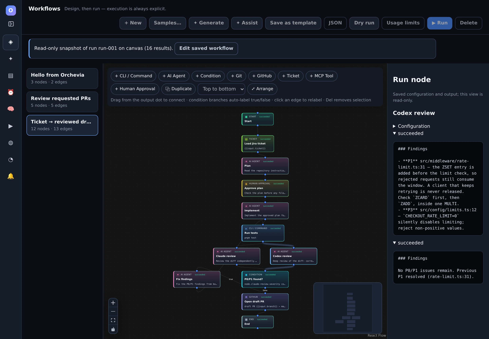
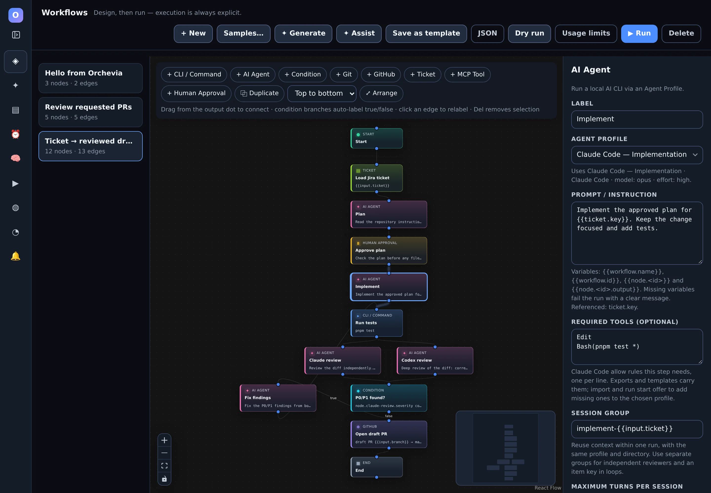
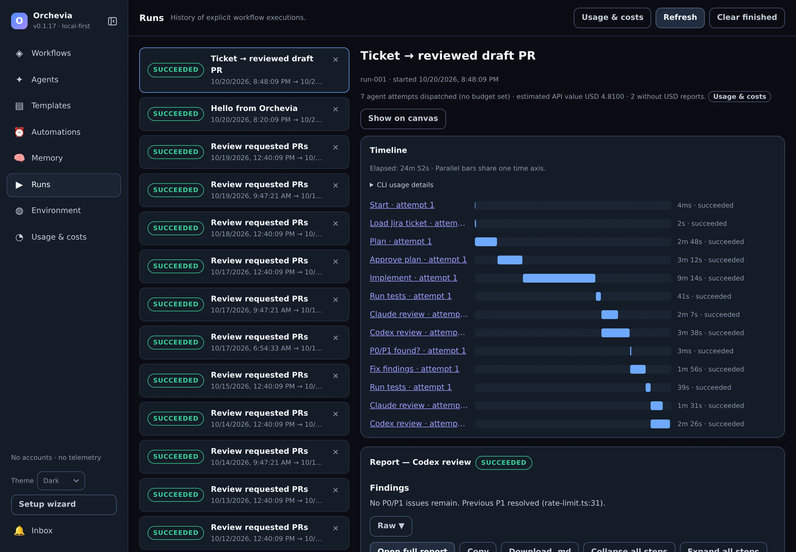
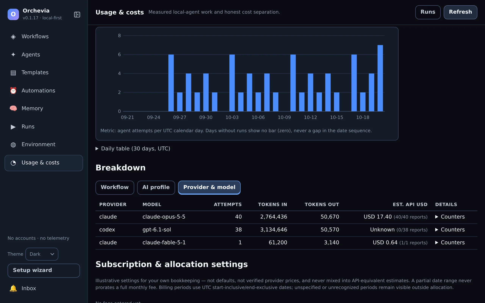
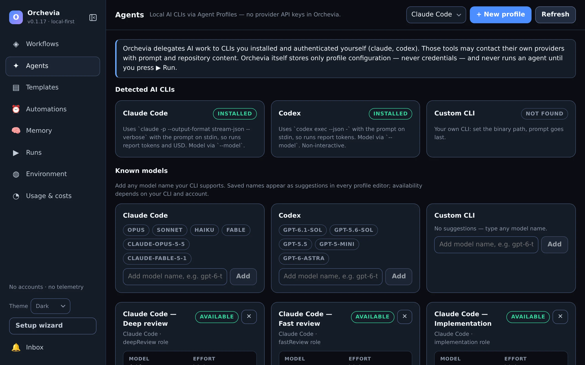
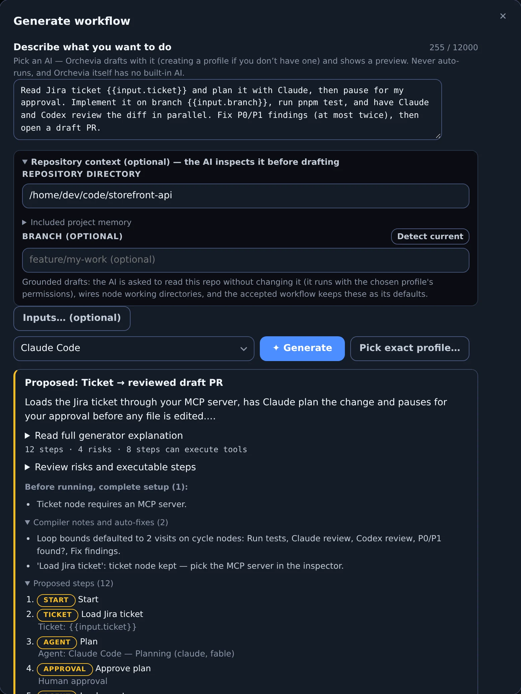

<div align="center">


# Orchevia

**Run your Claude Code and Codex CLIs as reviewable, repeatable pipelines — on your own machine.**

[](https://github.com/iazaran/orchevia/actions/workflows/ci.yml)
[](https://github.com/iazaran/orchevia/releases/latest)
[](https://github.com/iazaran/orchevia/releases)
[](./LICENSE)

[](./docs/architecture.md)
[](https://github.com/iazaran/orchevia/stargazers)

[**Download**](#download) · [Website](https://iazaran.github.io/orchevia/) ·
[Getting started](./docs/getting-started.md) · [Docs](./docs/architecture.md) ·
[Changelog](./CHANGELOG.md) · [Report an issue](https://github.com/iazaran/orchevia/issues/new/choose)



</div>

Orchevia is a **local-first desktop app** that turns the work you already do with AI
coding CLIs into a graph you can inspect, repeat and share. Describe a task —
_"plan this ticket with Claude, let me approve it, implement, run the tests, have Claude
and Codex review, fix P0/P1 findings, open a draft PR"_ — check the graph, press **Run**,
and every step executes through **tools already installed on your machine**: Claude
Code, Codex, `git`, `gh`, your test commands.

**Orchevia is not an AI provider.** There is no Orchevia account, no model API key
field, no telemetry and no hosted runner. AI work goes through the CLIs you installed
and signed in to yourself, so it uses your existing subscription and its limits.

## Why developers use it

- 🔑 **Your subscriptions, not API bills.** Agent steps call your own `claude` and
  `codex` CLIs. No keys to paste and no per-token invoice from Orchevia.
- 🤝 **Claude and Codex in one pipeline.** Let one model implement and the other review,
  in parallel, with findings normalized to P0–P3.
- 🧭 **Predictable, not autonomous.** A fixed graph of commands, agents, conditions,
  approvals, bounded loops and timeouts. Nothing runs until you press Run.
- ✋ **You stay in the loop.** Durable Human Approval gates, read-only run snapshots,
  cancel at any time, and deliberate recovery of failed runs.
- 🔒 **Local and honest.** Workflows and history live in local SQLite, tool permissions
  are explicit, automation that writes is trust-gated, and CLI-reported usage is kept
  apart from estimates.

## Download

Pick the installer for your machine from the **[latest release](https://github.com/iazaran/orchevia/releases/latest)**:

| Platform              | Installer                                                                                                                                                                                                |
| --------------------- | -------------------------------------------------------------------------------------------------------------------------------------------------------------------------------------------------------- |
| macOS · Apple Silicon | [Orchevia-macos-arm64.dmg](https://github.com/iazaran/orchevia/releases/latest/download/Orchevia-macos-arm64.dmg)                                                                                        |
| macOS · Intel         | [Orchevia-macos-x86_64.dmg](https://github.com/iazaran/orchevia/releases/latest/download/Orchevia-macos-x86_64.dmg)                                                                                      |
| Linux · x86_64        | [AppImage](https://github.com/iazaran/orchevia/releases/latest/download/Orchevia-linux-x86_64.AppImage) · [.deb](https://github.com/iazaran/orchevia/releases/latest/download/Orchevia-linux-x86_64.deb) |
| Checksums             | [SHA256SUMS](https://github.com/iazaran/orchevia/releases/latest/download/SHA256SUMS)                                                                                                                    |

<details>
<summary><strong>Install steps and checksum verification</strong></summary>

Download your installer and `SHA256SUMS` into the same folder, keep the published file
names, and check for an `OK` line:

```bash
# Linux
sha256sum -c SHA256SUMS --ignore-missing
# macOS
shasum -a 256 -c SHA256SUMS --ignore-missing
```

- **macOS:** open the DMG and drag Orchevia to Applications. Builds are not signed or
  notarized yet, so macOS blocks the first launch. Either run
  `xattr -d com.apple.quarantine /Applications/Orchevia.app`, or try to open the app once
  and choose **Open Anyway** in **System Settings → Privacy & Security**.
- **Linux (.deb):** `sudo apt install ./Orchevia-linux-x86_64.deb`
- **Linux (AppImage):** `chmod +x Orchevia-linux-x86_64.AppImage`, then run it.

Orchevia tells you when a new version is ready (a banner, an Inbox entry and the
installer link under **Environment → Updates**, where you can also turn the check
off). It does not install updates by itself yet: install the new file over the old
one, and your workflows and history are kept.

</details>

**Before your first AI run:** install and sign in to at least one AI CLI
([Claude Code](https://github.com/anthropics/claude-code) or
[Codex](https://github.com/openai/codex)). The setup
wizard detects `git`, `gh`, `claude` and `codex`, including CLIs on your login shell's
`PATH` (nvm, fnm, Homebrew, `~/.local/bin`). A command-only workflow needs no AI CLI.

## Your first workflow in 5 minutes

1. **Open Orchevia.** The setup wizard detects your tools and creates recommended
   Claude and Codex profiles.
2. **Workflows → Samples… → Plan → Implement → Review → Create.** Claude plans, you
   approve the plan, Claude implements, Codex reviews.
3. **Select a node** to set its profile, prompt and timeout. Badges on the canvas flag
   anything missing before you run.
4. **Press ▶ Run.** Watch progress on the canvas, approve the paused gate, and read each
   step's live output in **Runs**. Opening a workflow never runs it.
5. **Go further:** describe a goal with **✦ Generate**, save flows as **Templates**, or
   schedule them under **Automations**.

Prefer to start without AI? The [getting-started guide](./docs/getting-started.md)
begins with a one-node [`echo` workflow](./docs/examples/hello-workflow.json).

> [!TIP]
> Headless Claude Code and Codex cannot ask for permission mid-run. Decide once, in the
> setup wizard or **Environment → Agent permissions**: let agents work without asking
> (full access), or keep each CLI's own settings. With the CLI settings, a refused
> tool fails the step with **tools refused** and the exact allow rules to add.

## See it in action

<table>
<tr>
<td width="50%" valign="top">

**Edit on a canvas.** Every node has an inspector: agent profile, prompt with
`{{variables}}`, required tools, session reuse, timeouts and loop bounds. Simple JSON
stays in sync.



</td>
<td width="50%" valign="top">

**Inspect every run.** A timeline shows parallel steps on one time axis, each step's
output and findings, which context a step resumed, and what each CLI reported.



</td>
</tr>
<tr>
<td width="50%" valign="top">

**Know what it used.** Agent attempts, tokens and tool calls per workflow, profile and
model. CLI-reported dollar estimates stay separate from what you actually pay.



</td>
<td width="50%" valign="top">

**Profiles per role.** Planning, implementation, fast and deep review: each with its own
CLI, model, effort and permission level. CLIs are found on your login shell's `PATH`.



</td>
</tr>
</table>

## Generate a workflow from a goal



1. Open **Workflows → ✦ Generate**, pick Claude Code or Codex, and optionally point it at
   a repository so the draft uses your real paths and conventions. The AI is asked to
   inspect it without changing anything, but it runs with that profile's permissions.
2. Write the goal like a short spec. Name the agents, the commands that prove the change
   works, where you want to approve, and which writes are allowed:

   > Read Jira ticket {{input.ticket}} and plan it with Claude, then pause for my
   > approval. Implement it on branch {{input.branch}}, run pnpm test, and have Claude
   > and Codex review the diff in parallel. Fix P0/P1 findings (at most twice), then open
   > a draft PR.

3. Review the preview: steps, risk categories, setup items (such as picking the Jira MCP
   server) and every compiler repair. **Ask AI to fix** sends blocking problems back for
   another round.
4. **Accept & edit** opens it on the canvas. Run it with **Dry run** fixtures first if you
   want to test the routing without executing anything.

Generation prefers native Agent, Git, GitHub, Ticket, MCP, Condition and Approval nodes;
Command nodes cover your own tools. Explicit instructions such as "CLI only" win.
**✦ Assist** improves or rearranges an existing workflow through the same reviewed preview.

<br clear="all" />

## What you get

- **Visual workflow canvas.** Start, Command, Human Approval, AI Agent, Condition, Git,
  GitHub, Ticket (Jira via MCP), MCP Tool and End nodes; validation badges, run overlays,
  dependency-aware layout, and Simple/Advanced JSON.
- **Real control flow.** Constrained conditions (no scripting), parallel branches with
  joins, failure edges, bounded retries with backoff, guarded review/fix loops, per-node
  timeouts and typed workflow inputs.
- **Agent profiles.** Claude Code, Codex or any custom CLI, with model, effort, skills,
  working directory and a **Permissions** level: the app-wide choice you make once
  (full access or your CLI settings), or the profile's own CLI settings, explicit allow
  list or full access.
- **Integrations.** Safe Git operations (dirty or lossy states refused), GitHub through
  your own `gh` (draft PRs, checks, comments), Jira tickets and other tools through your
  MCP servers.
- **Local automation.** Durable schedules, PR review and feedback watchers with bot-loop
  guards, a notification inbox, and opt-in background mode. Schedules that write need a
  per-schedule trust opt-in.
- **Reuse and memory.** Nine ready-to-run built-in templates (pick a repository,
  answer the run form) plus your own, versioned JSON
  import/export, and a project playbook of accepted commands and conventions.
- **Run controls.** Dry runs with fixtures, agent-attempt budgets, an optional guard on
  CLI-reported spend, and recovery of failed runs from their original inputs.

## Workflow recipes

| Start with                | Typical sequence                                           | What you configure                                   |
| ------------------------- | ---------------------------------------------------------- | ---------------------------------------------------- |
| A change you want to make | Plan → Approve → Implement → Test → Review                 | Repository, agent profiles, real test command        |
| A tracked ticket          | Read Ticket → Plan → Approve → Implement → Test → Draft PR | Jira MCP, `git`/`gh`, profiles, explicit write steps |
| An existing PR            | Read PR → Independent reviews → Summarize → Human decision | Authenticated `gh`, PR input, reviewer profiles      |
| A nightly sweep           | Schedule or watcher → Review → Inbox notification          | Trusted schedule, read-only scope, reviewer profiles |

Keep commits, pushes, comments and PR creation explicit in the graph. A review or a
passing test never merges anything unless you add that write step.

## Choose the right node

| Work                                              | Node                       | Configuration                        |
| ------------------------------------------------- | -------------------------- | ------------------------------------ |
| Implement, plan, or review code                   | AI Agent                   | Profile, prompt, repository, timeout |
| Inspect a repository or manage branches/worktrees | Git                        | Supported operation and repository   |
| Inspect a PR, create a draft PR, or add a comment | GitHub                     | Operation through authenticated `gh` |
| Read a Jira ticket                                | Ticket                     | Enabled MCP server and ticket key    |
| Call another integration operation                | MCP Tool                   | Discovered tool and JSON arguments   |
| Run tests, Docker, or unsupported CLI operations  | Command                    | Executable and separate arguments    |
| Choose a path or pause for a decision             | Condition / Human Approval | Condition or approval message        |

More: [execution semantics](docs/execution.md), [agent profiles and permissions](docs/agents.md),
[scheduling](docs/scheduling.md), [workflow costs](docs/workflow-costs.md) and the
[workflow schema](docs/workflow-schema.md).

## Safety model

- **Explicit execution.** Opening, importing or previewing a workflow never runs it.
  Executables and arguments are passed separately; a shell runs only when a Command node
  asks for one.
- **Permissions you can read.** Profiles pass permission flags only on the command line;
  Orchevia never edits your Claude Code or Codex settings. Tools that Claude Code refuses
  fail the step instead of passing silently.
- **Untrusted input stays data.** Ticket text, PR content, imported workflows and AI
  output are treated as untrusted. Imports refuse files that contain credential-like
  fields.
- **Your machine, your permissions.** Steps run with your user permissions and are not
  sandboxed. Cancel and timeouts stop the step's process group on Linux and macOS.

Details: [security model](./docs/security.md) and [SECURITY.md](./SECURITY.md).

## Current limits

- **Beta:** Linux x86_64 and macOS (Apple Silicon and Intel). Windows is not supported
  yet. macOS builds are unsigned and not notarized.
- **Tools and sign-in:** install and authenticate CLIs yourself. Orchevia reads only
  `PATH` from your login shell; Jira and other MCP servers may need credentials in the
  environment the app was started from.
- **Local scheduling:** the app must be running. Background mode keeps it running when
  the window closes (with a tray icon where the desktop shows one); there is no cloud
  worker.
- **Refusal detection:** Codex reports no refusal events, and neither do Claude profiles
  whose extra arguments force text output (`--output-format`), so refused tools in
  those steps are not detected.

## Build from source

```bash
git clone https://github.com/iazaran/orchevia.git
cd orchevia
pnpm install
pnpm tauri dev   # the desktop app; `pnpm dev` is a browser demo with a mock backend
```

You need Node.js 24+, pnpm 10+, Rust stable, and the platform dependencies in
[the development guide](./docs/development.md). The project is split into `src/`
(React UI behind a typed `Backend` interface), `src-tauri/` (thin desktop commands) and
`crates/core/` (workflow model, validation, DAG engine, SQLite, scheduler, CLI adapters
and the generation compiler). Run the same checks as CI before opening a PR:

```bash
pnpm check
cargo test -p orchevia-core
cargo clippy -p orchevia-core --all-targets -- -D warnings
cargo fmt --check
cargo check -p orchevia
```

## Contributing and support

Contributions are welcome: workflow recipes, clearer setup guidance, accessibility
improvements, bug reports with a redacted log, or code. Start with
[CONTRIBUTING.md](./CONTRIBUTING.md), the [Code of Conduct](./CODE_OF_CONDUCT.md) and the
[roadmap](./ROADMAP.md). Questions go through [SUPPORT.md](./SUPPORT.md); please report
vulnerabilities privately as described in [SECURITY.md](./SECURITY.md).

If Orchevia saves you a few terminal round-trips, a ⭐ helps other developers find it.

## License

Apache-2.0 — see [LICENSE](./LICENSE).
