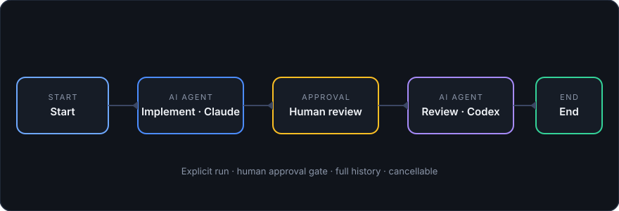

# Orchevia

> **Describe the task once. Inspect the plan as a graph. Let your own AI CLIs do the work.**

[](./LICENSE)

[Download installers](#install) · [Getting started](./docs/getting-started.md) · [Project site](https://iazaran.github.io/orchevia/) · [Documentation](./docs/architecture.md) · [Changelog](./CHANGELOG.md) · [Contributing](./CONTRIBUTING.md) · [Report an issue](https://github.com/iazaran/orchevia/issues/new/choose)

Orchevia is a **local-first** desktop app for visual developer workflows. You describe
a task — _"implement this ticket with Claude, review with Codex, open a draft PR"_ — inspect
it as a graph of steps, press **Run**, and each step executes through **tools already
installed on your machine**: Claude Code, Codex, `git`, `gh`, your test commands.

**Orchevia is not an AI provider.** No Orchevia account, model API key configuration, telemetry, or hosted execution service.
AI work is delegated to CLIs you installed and authenticated yourself.

**Who it's for:** developers who already drive Claude Code / Codex from the terminal and want
repeatable, inspectable, one-click flows (plan → approve → implement → review, ticket →
branch → draft PR, nightly review sweeps) without sending code to an Orchevia service. Your AI CLIs may contact their own providers.



## Why Orchevia

Turn a familiar sequence of terminal tasks into a workflow you can inspect,
repeat, and share. Keep your existing CLIs and repository conventions while
making the handoffs visible: which agent plans, when tests run, who reviews,
and where you approve a write.

| Developer need                                       | How Orchevia helps                                                    |
| ---------------------------------------------------- | --------------------------------------------------------------------- |
| Repeat a task without rebuilding the prompt sequence | Save a workflow or template with typed inputs.                        |
| Use different agents for implementation and review   | Assign a profile to each step and inspect its output.                 |
| Stay involved before important decisions             | Put a durable Human Approval gate in the graph.                       |
| Understand a failed run                              | Inspect live output, per-step results, and the exact saved run graph. |
| Reuse repository-specific knowledge                  | Save accepted commands and conventions in a project playbook.         |
| Keep orchestration on your own machine               | Store workflows and history locally; use your own CLI authentication. |

Orchevia fits developers who already use local CLIs and want explicit, repeatable
coordination. It is in beta: start with a small manual flow before scheduling
writes. CLI usage costs and remote-provider behavior remain with your chosen tools.

## Install

Release v0.1.16 is being prepared. The permanent installer links below target this
version; they become available after the matching tag's release workflow succeeds
(pending publication).
See the [release notes](https://github.com/iazaran/orchevia/releases/tag/v0.1.16).
Until then, use the [published v0.1.15 installers](https://github.com/iazaran/orchevia/releases/tag/v0.1.15).
A merged PR alone does not build installers.

The repository and release files are **private for now**: sign in to GitHub with an
account that has repository access. The repository and downloads will be public soon.

| Platform                    | Installer                                                                                                                                                                                                  |
| --------------------------- | ---------------------------------------------------------------------------------------------------------------------------------------------------------------------------------------------------------- |
| macOS Apple Silicon (arm64) | [.dmg](https://github.com/iazaran/orchevia/releases/download/v0.1.16/Orchevia-macos-arm64.dmg)                                                                                                             |
| macOS Intel (x86_64)        | [.dmg](https://github.com/iazaran/orchevia/releases/download/v0.1.16/Orchevia-macos-x86_64.dmg)                                                                                                            |
| Linux x86_64                | [AppImage](https://github.com/iazaran/orchevia/releases/download/v0.1.16/Orchevia-linux-x86_64.AppImage) · [.deb](https://github.com/iazaran/orchevia/releases/download/v0.1.16/Orchevia-linux-x86_64.deb) |

Download your installer and [SHA256SUMS](https://github.com/iazaran/orchevia/releases/download/v0.1.16/SHA256SUMS)
into the same directory, keep the published filenames, then verify your download:

```bash
# Linux
sha256sum -c SHA256SUMS --ignore-missing
# macOS
shasum -a 256 -c SHA256SUMS --ignore-missing
```

Require an `OK` result for your installer. macOS installers are unsigned and not
notarized; on first launch, right-click the app and choose **Open**. See the release
notes for the quarantine-removal command.

Contributors can inspect [CI checks](https://github.com/iazaran/orchevia/actions/workflows/ci.yml)
and the [release workflow](https://github.com/iazaran/orchevia/actions/workflows/release.yml)
while signed in; private workflow badges do not load reliably for readers.

### Build from source

Contributors with repository access can also build from source:

```bash
git clone https://github.com/iazaran/orchevia.git
cd orchevia
pnpm install
pnpm tauri dev
```

You need Node.js 24+, pnpm 10+, Rust stable, and the platform dependencies listed in
[the development guide](./docs/development.md). `pnpm dev` opens a browser demo backed
by localStorage; it does **not** run real CLI processes. The desktop app does.

Optional tools (`git`, `gh`, `claude`, `codex`) are detected locally, including CLIs
installed through your login shell's `PATH` (nvm, fnm, Homebrew); install and
authenticate the ones your workflows need.

## Your first workflow in 5 minutes

New to the app? The [getting-started guide](./docs/getting-started.md) begins with
[a small `echo` workflow](./docs/examples/hello-workflow.json) that needs no AI
profile, then shows how to add agents, tests, approval and reuse.

1. **Open Orchevia** — the first-run wizard detects your tools and creates Claude + Codex
   agent profiles. (Reopen it anytime from the sidebar.)
2. **Workflows → Samples… → Plan → Implement → Review → Create.** A ready-made graph
   appears on the canvas: Claude plans, **you approve the plan**, Claude implements,
   Codex reviews.
3. **Select any node** to configure it (profile, prompt, timeout). Validation badges on
   the canvas tell you what's missing before you run.
4. **Press ▶ Run.** Execution is always explicit — opening a workflow never runs it.
   Watch progress on the canvas, inspect live per-node stdout/stderr under **Runs**, approve
   the paused gate, or cancel anytime.
5. **Go further:** describe a goal with **✦ Generate** (your local CLI drafts a validated
   preview — never auto-runs), save flows as reusable **Templates**, or schedule nightly
   runs under **Automations**.

```text
Start → Implement (Claude) → Human Approval → Review (Codex) → End
```

## What you get

- **Visual workflow canvas** — Start, Command, Human Approval, AI Agent, Condition,
  Git, GitHub, Ticket (Jira via MCP), MCP Tool, End nodes; edge labels, validation
  badges, run-status overlays, duplication, and a readable starting view for large flows.
- **Real control flow** — constrained conditions (no scripting), parallel branches with
  joins, failure-recovery edges, bounded retries with backoff, guarded review/fix loops,
  per-node timeouts, typed workflow inputs.
- **Agent Profiles** — per-CLI model/effort/working-directory configuration for Claude
  Code, Codex, or any custom CLI; optionally select installed CLI skills for a profile
  or let the CLI choose them. `{{variable}}` prompt templating uses inputs and upstream
  outputs; missing CLIs fail validation clearly.
- **Git/GitHub/Jira integrations** — safe git ops (dirty/lossy states refused),
  GitHub via your own `gh` (draft PRs, checks, comments), Jira tickets via a local MCP
  server, generic MCP tool calls with provenance.
- **Local automation** — durable schedules, opt-in tray background mode, GitHub
  review/feedback watchers with bot-loop guards, normalized P0–P3 findings,
  trust-gated writes, notification center.
- **Local-first persistence** — workflows, runs, profiles, schedules, templates, and
  memory live in SQLite on your machine, with versioned JSON import/export.
  Authentication stays in your CLI or MCP server configuration.
- **Explicit execution** — executables and arguments are passed separately; a Command node
  can explicitly invoke a shell. The active child is stopped
  on cancel, ticket/PR content is treated as untrusted input.

How it fits together: [docs/architecture.md](./docs/architecture.md) ·
[workflow schema](./docs/workflow-schema.md) · [security model](./docs/security.md) ·
[site source](./docs/index.html).

## Workflow recipes

| Start with                | Typical sequence                                           | What you configure                                   |
| ------------------------- | ---------------------------------------------------------- | ---------------------------------------------------- |
| A change you want to make | Plan → Approve → Implement → Test → Review                 | Repository, agent profiles, real test command        |
| A tracked ticket          | Read Ticket → Plan → Approve → Implement → Test → Draft PR | Jira MCP, `git`/`gh`, profiles, explicit write steps |
| An existing PR            | Read PR → Independent reviews → Summarize → Human decision | Authenticated `gh`, PR input, reviewer profiles      |

Use supported native nodes for Git, GitHub, Ticket and MCP operations. A Command
node covers your project's tools and unsupported operations. Keep commit, push,
comment, and PR creation explicit in the graph. A review or a successful test step
does not merge anything unless you add an authorized write operation.

## Author, inspect, reuse

**Simple JSON** uses readable node keys and portable profile selections. The
canvas and JSON editor stay in sync; **Advanced JSON** keeps the full runtime
format available. Arrange graphs by dependencies when they become hard to follow.
Save reusable **Templates** with inputs instead of duplicating project-specific
values. In **Memory**, maintain project commands, conventions and review choices;
accept suggestions deliberately or promote a command from a successful run.

**Runs** keeps the workflow snapshot used for each execution, so later edits do
not change the graph you are inspecting. Output and failures belong to individual
steps. Local **Automations** can repeat a proven flow while the app stays running;
review scope and trust permissions before enabling writes.

## How generation works

A configured local AI CLI drafts a proposal. Orchevia validates and compiles it into a
preview you can edit before running. It uses native Agent, Git, GitHub, Ticket, MCP,
Condition, and Approval nodes when they fit the goal; Command nodes cover local tools
and unsupported operations. Explicit instructions such as “CLI only” take priority.
Compiler notes show any repair or setup needed before you accept the workflow.

## Choose the right node

| Work                                              | Node                       | Configuration                        |
| ------------------------------------------------- | -------------------------- | ------------------------------------ |
| Implement, plan, or review code                   | AI Agent                   | Profile, prompt, repository, timeout |
| Inspect a repository or manage branches/worktrees | Git                        | Supported operation and repository   |
| Inspect a PR, create a draft PR, or add a comment | GitHub                     | Operation through authenticated `gh` |
| Read a Jira ticket                                | Ticket                     | Enabled MCP server and ticket key    |
| Call another integration operation                | MCP Tool                   | Discovered tool and JSON arguments   |
| Run tests, Docker, or unsupported CLI operations  | Command                    | Executable and separate arguments    |
| Choose a path or pause for a decision             | Condition / Human Approval | Condition or approval message        |

For example, declare a `ticket` input and ask Generate:

> Read Jira ticket {{input.ticket}}, plan its implementation with Claude, pause for
> my approval, implement and run the repository's tests, then request one Codex
> review. Use native nodes and leave all changes uncommitted.

Review the preview's setup checklist, assign the intended profiles, and inspect
write operations before accepting. A goal is a draft specification; generation is
not a guarantee that every requested integration operation is supported.

## Workflow testing and run controls

Use **Dry run** to supply successive node-result fixtures and test routing without
executing tools. Claude and Codex Agent nodes report CLI token usage (Claude also
reports an estimated API value in USD). **Run options** adds an optional guard on
that reported estimate. Dollar values live in collapsed **CLI usage details**;
they are not your subscription bill or remaining quota. Runs show parallel timing
and estimate coverage; failed runs offer deliberate recovery
using the original workflow and inputs. Reused output and simulated tests stay
separate from actual execution/spend and verified project knowledge.

See [execution semantics](docs/execution.md#dry-run-workflow-tests),
[reported-spend controls](docs/workflow-costs.md#reported-spend-guard) and
[the run-control contract](docs/workflow-schema.md#run-controls).

## Current limits

- **Beta:** source version 0.1.16 targets Linux x86_64 and macOS Apple Silicon/Intel.
  Windows is not supported. macOS installers are unsigned and not notarized.
- **Tools and authentication:** install and authenticate CLIs yourself. Orchevia reads
  only `PATH` from your login shell; Jira and other MCP servers may need credentials
  in the environment the app itself was started with.
- **Local scheduling:** the app must stay running; enable background mode to keep
  schedules active after closing the window. There is no remote worker service.
- **Execution permissions:** commands and agents run with your user permissions.
  Orchevia does not sandbox them. A Command node can explicitly invoke a shell.
- **Profiles and skills:** model availability depends on your CLI/account. Skill
  discovery reads metadata; use a small workflow to check that a skill loads.

## For developers

- `src/`: React editor and a typed `Backend` interface. `pnpm dev` uses the
  browser mock to iterate on views and interactions without native processes.
- `src-tauri/`: desktop shell and thin commands that expose core behavior.
- `crates/core/`: workflow schema, validation, DAG engine, local SQLite,
  scheduler, CLI adapters, Git/GitHub/MCP integrations, and generation compiler.
- `docs/`: architecture, [workflow schema](./docs/workflow-schema.md),
  [security model](./docs/security.md), and the [development guide](./docs/development.md).

Run the same checks used by CI before a PR:

```bash
pnpm check
cargo test -p orchevia-core
cargo clippy -p orchevia-core --all-targets -- -D warnings
cargo fmt --check
cargo check -p orchevia
```

## Roadmap

Short version: visual editor → agent profiles → advanced engine → Git/GitHub/Jira/MCP →
scheduling & PR review loops → NL generation + local memory → hardening → public beta.
Full version: [ROADMAP.md](./ROADMAP.md).

## Contributing

Contributions are welcome! Start with [CONTRIBUTING.md](./CONTRIBUTING.md) and the
[Code of Conduct](./CODE_OF_CONDUCT.md).

## Security

See [SECURITY.md](./SECURITY.md). Orchevia executes local commands on your behalf:
workflows are explicit, commands can be previewed before running, and ticket/PR
content is treated as untrusted input. Output is stored locally and may contain
sensitive data; review it before sharing.

## Support

Questions? See [SUPPORT.md](./SUPPORT.md) for where to ask and how to file useful bug reports.

## License

Apache-2.0 — see [LICENSE](./LICENSE).

Agent nodes can [reuse context and pass bounded handoffs](docs/workflow-costs.md)
within a run. New AI samples/templates and workflow generation use these optional
controls while preserving independent reviews.
